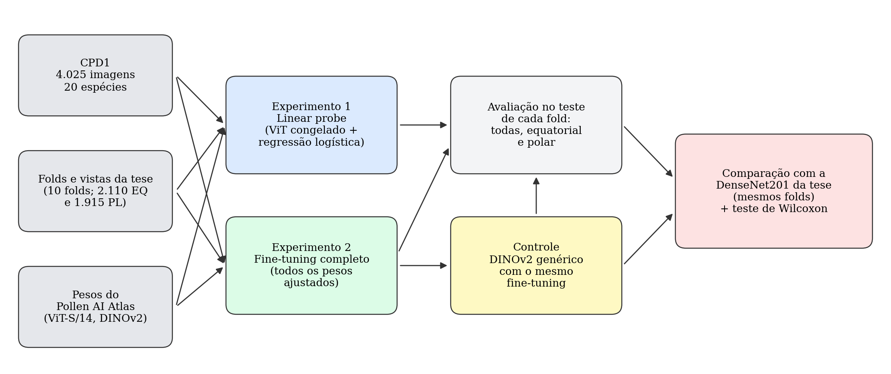
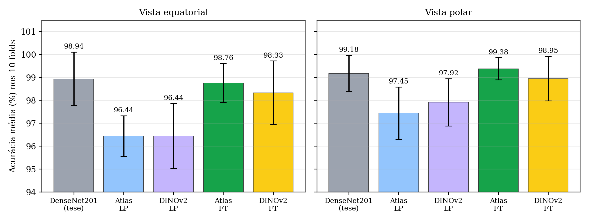
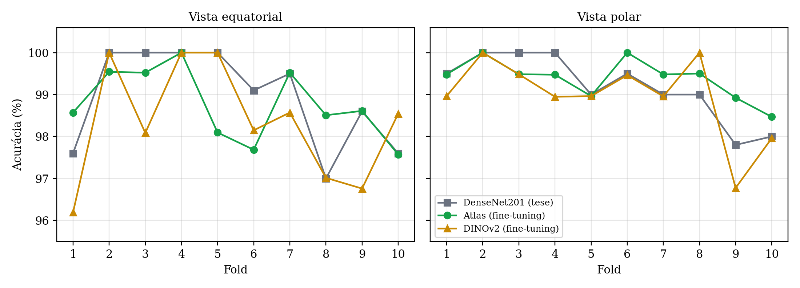

# Pollen AI Atlas × classificação de pólen por vistas (CPD1)

Iniciação científica — Universidade Federal do Piauí (UFPI)
**Autora:** Monnik Luianne Oliveira Nascimento Veloso Barbosa · **Orientador:** Prof. Dr. Kelson Rômulo Teixeira Aires

Este repositório integra o **[Pollen AI Atlas](https://github.com/abiricz/pollen-ai-atlas-paper)** — um Vision Transformer (ViT-S/14, família DINOv2) ajustado com cerca de 1,5 milhão de grãos de pólen — ao pipeline de classificação por **vista equatorial e polar** da tese de [Soares et al. (2025)](https://ieeexplore.ieee.org/document/10948458), no **Cretan Pollen Dataset (CPD1)**.

**Pergunta:** usar o Pollen AI Atlas melhora os resultados obtidos na tese com a DenseNet201?



## Resultados (média ± desvio nos 10 folds da tese)

| Modelo | Vista equatorial | Vista polar |
|---|---|---|
| DenseNet201 (tese) | 98,94 ± 1,17 | 99,18 ± 0,79 |
| Atlas — linear probe | 96,44 ± 0,89 | 97,45 ± 1,14 |
| DINOv2 genérico — linear probe | 96,44 ± 1,42 | 97,92 ± 1,03 |
| **Atlas — fine-tuning** | **98,76 ± 0,85** | **99,38 ± 0,48** |
| DINOv2 genérico — fine-tuning | 98,33 ± 1,39 | 98,95 ± 0,97 |

Teste de Wilcoxon pareado por fold (α = 0,05):

- **Linear probe × DenseNet201:** a tese foi significativamente melhor nas duas vistas (p ≤ 0,004).
- **Atlas com fine-tuning × DenseNet201:** sem diferença significativa (p = 0,59 na equatorial; p = 0,66 na polar), com menor desvio padrão.
- **Atlas × DINOv2 genérico, ambos com fine-tuning:** Atlas +0,43 ponto nas duas vistas; significativo na polar (p = 0,031), não na equatorial (p = 0,46).

**Conclusão:** congelado, o Atlas não alcança a tese; com fine-tuning, fica estatisticamente equivalente à DenseNet201, mais estável entre os folds e melhor que o ViT genérico na vista polar.




Relatório completo (formato SBC): [`docs/relatorio_sbc.pdf`](docs/relatorio_sbc.pdf) · Guia visual didático: [`docs/guia_visual.pdf`](docs/guia_visual.pdf)

## Estrutura

```
notebooks/
  01_linear_probe_folds_tese.ipynb     Experimento 1 — ViT congelado + regressão logística (Atlas e DINOv2)
  02_finetuning_atlas_dinov2.ipynb     Experimento 2 — fine-tuning completo (Atlas) e controle (DINOv2)
  02b_finetuning_dinov2_kaggle.ipynb   versão do Experimento 2 adaptada para o Kaggle
dados/
  vistas_folds_julio_CPD1.csv          fold (1–10) e vista de cada uma das 4.025 imagens, iguais aos da tese
  baseline_DenseNet201_tese_por_fold.xlsx   métricas por fold da DenseNet201 da tese (referência)
resultados/
  linear_probe/acuracia_por_fold.csv   Experimento 1
  finetuning/metricas_por_fold.csv     Experimento 2 e controle (acurácia, precisão, recall, F1, kappa, tempo)
docs/                                  relatório SBC e guia visual
figuras/                               figuras do relatório
```

## Como reproduzir

**1. Preparar a base (no PC, com o código da tese).** Clone [Pollen_classification_view](https://github.com/jczars/Pollen_classification_view), crie um ambiente Conda com Python 3.10.13 e rode, com `PYTHONPATH` apontando para a raiz do projeto:

```bash
python preprocess/rename_folders.py --path_data "BD/Cropped Pollen Grains/"
python preprocess/resize_img_bd.py --config preprocess/config_resize.yaml
python preprocess/split_aug_bd_k.py --config preprocess/config_origin_format.yaml
```

A base CPD1 está em <https://zenodo.org/records/4756361> (arquivo *Cropped Pollen Grains*). Os notebooks usam só as imagens originais da pasta `BD/CPD1_Cr_Rs_400/Test`; os folds e as vistas vêm de `dados/vistas_folds_julio_CPD1.csv`.

**2. Baixar os pesos do Atlas:** `weights_vit_small_lvd_20250620_0312.pth`, na pasta `01_initialization` do [repositório do Pollen AI Atlas](https://github.com/abiricz/pollen-ai-atlas-paper).

**3. Rodar no Google Colab (GPU T4).** Coloque no Google Drive, em `IC_Polen/`: o ZIP da pasta `CPD1_Cr_Rs_400`, o arquivo `.pth` e os dois arquivos de `dados/`. Abra os notebooks e ajuste só a célula de configuração. No notebook 02, use `MODELOS_FT = ["Atlas", "DINOv2"]` e `FOLDS = list(range(1, 11))` para repetir tudo. Cada fold de fine-tuning leva de 3 a 7 minutos; os resultados são salvos fold a fold, e o treino pode ser retomado se o Colab desconectar.

## Notas técnicas

- **Folds e vistas da tese.** A base com as vistas separadas não estava mais disponível, e gerar os folds de novo não reproduz a divisão original (a ordem dos arquivos muda entre Linux e Windows). Por isso, folds e vistas foram reconstruídos a partir de `results/phase3/CPD1_TEST_VIEW` do repositório [Pollen-Classification-CBAM](https://github.com/jczars/Pollen-Classification-CBAM).
- **Correção para Windows no código da tese.** Em `models/split_BD_Views_k.py`, a função `copy_images` separava caminhos com `/`. Substituir:
  ```python
  folder = file_path.split('/')[-2]
  filename = file_path.split('/')[-1]
  ```
  por:
  ```python
  folder = os.path.basename(os.path.dirname(file_path))
  filename = os.path.basename(file_path)
  ```
- **Dependências no Windows.** `tensorflow-addons==0.23.0` não tem versão para Windows; para o pré-processamento bastam: `numpy==1.26.4 pandas==2.2.3 opencv-python==4.8.1.78 imageio==2.33.1 imgaug==0.4.0 tqdm==4.66.2 PyYAML==6.0.1 scikit-learn==1.4.0 matplotlib==3.8.0 seaborn==0.13.2 openpyxl==3.1.2`.
- **Imagens aumentadas (`aug_*`) não são usadas** nos notebooks: foram geradas a partir de outra divisão de folds e poderiam levar informação do teste para o treino. O aumento de dados é feito durante o treino, com as mesmas transformações da tese.

## Limitações

Uma execução por fold (uma semente); hiperparâmetros não otimizados; resultados da DenseNet201 reaproveitados do repositório da tese, sem reexecução. Com 10 folds, "não significativo" indica ausência de evidência de diferença, e não equivalência comprovada.

## Referências

- Soares, J. C. d. S., Aires, K. R. T., Bendini, J. d. N., Brandão, W. V. B. e Veras, R. d. M. S. (2025). Enhanced pollen classification via hybrid neural network with attention mechanism and view separation: an equatorial and polar approach. *IEEE Access*, 13:77365–77381.
- Biricz, B. et al. (2026). Million-scale multimodal pollen microscopy with expert-guided foundation models. *arXiv:2606.17809*.
- Tsiknakis, N. et al. (2022). Pollen grain classification based on ensemble transfer learning on the Cretan Pollen Dataset. *Plants*, 11(7):919.
- Oquab, M. et al. (2024). DINOv2: Learning robust visual features without supervision. *Transactions on Machine Learning Research*.
